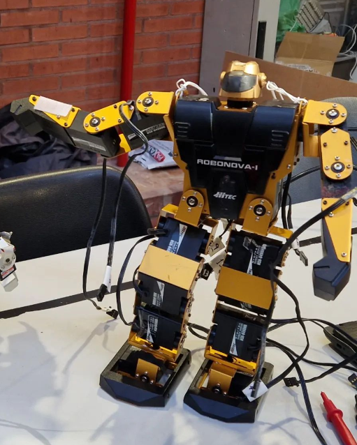
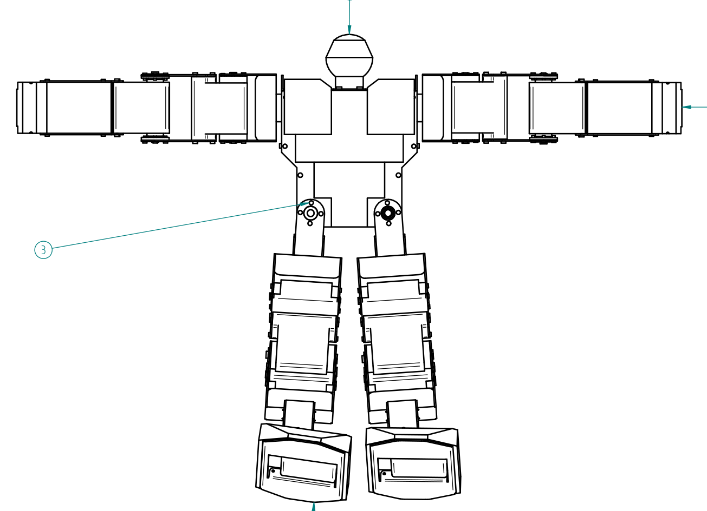

# Humanoid Robot - Solid Edge

CAD design files for a small humanoid robot developed in Solid Edge.

The project recreates an existing physical humanoid robot as a 3D CAD model.

<table>
  <tr>
    <td align="center"><strong>Physical robot</strong></td>
    <td align="center"><strong>CAD model</strong></td>
  </tr>
  <tr>
    <td></td>
    <td></td>
  </tr>
</table>

## Highlights

- Full robot assembly and subassemblies
- Solid Edge part files and technical drawings
- Project overview and documentation in PDF format

## Repository structure

```text
assemblies/     Solid Edge assemblies
parts/          Solid Edge parts
drawings/       Solid Edge draft files
docs/           Project overview
media/          Project images and presentation media
```

## Media

Project images are stored under `media/`.
